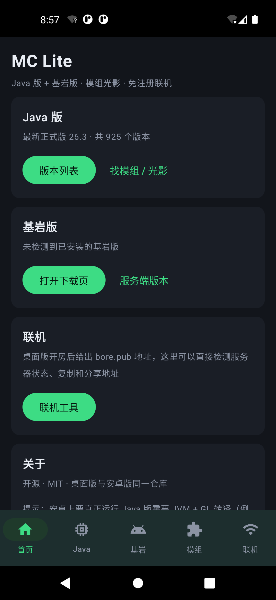
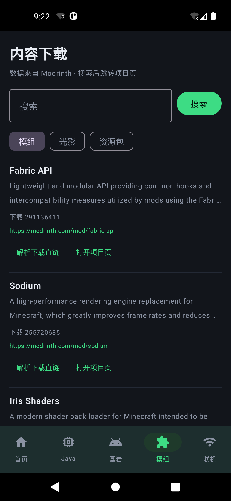

# MC Lite 启动器

一个 **Windows 开箱即用** 的 Minecraft 启动器：Java 版 + 基岩版统一管理，
能装游戏、装模组光影、开联机房间。界面用 tkinter 手写深色主题，
打包后的 `MCLite.exe` 是单文件，**不需要装 Python / Java / 任何运行库**就能启动
（Java 版游戏本身需要的 JDK 由启动器自动检测并下载 Temurin）。

> 纯 Python 标准库实现，源码无第三方依赖；MIT 协议开源。

## 下载

- 到 [Releases](../../releases) 下载 `MCLite.exe`，双击即用，绿色免安装。
- 想从源码跑：`启动.bat`（需要 Python 3.10+，仅标准库）。

## 功能

### Java 版
- 官方版本清单（正式版 / 快照 / 旧版本，900+ 版本），一键安装核心、依赖库、
  资源文件与日志配置，支持断点重下与 SHA1 校验
- 加载器：**Fabric**、**Quilt**、**Forge**、**NeoForge**
  （Forge/NeoForge 调用官方安装器并自动准备 `launcher_profiles.json`；
  官方源不可达时自动走 BMCLAPI 镜像）
- 登录方式：
  - 离线登录（自定义玩家名，单机/局域网可用）
  - 外置登录（authlib-injector，自动下载 jar 并注入 `-javaagent`，
    适配 LittleSkin 等皮肤站）
  - 微软正版（设备码流程，需自备 Azure 公开客户端 Client ID）
- 启动参数：内存、分辨率、自定义 JVM 参数；按版本自动匹配 Java 8/16/17/21/25，
  缺哪个版本就下载哪个

### 基岩版
- 自动检测本机已安装的 Minecraft（Windows 版），正式版 / 预览版可分别选择启动
- 服务端（BDS）多版本：官方正式版/预览版列表 + 按版本号下载历史版本
- 已下载服务端可单独启动（独立控制台，首次需在窗口内同意 EULA）或删除

### 内容下载
- 模组 / 光影 / 资源包，数据来自 [Modrinth](https://modrinth.com)
- **联网即预取**：启动器一拿到版本清单，后台就抓取热门模组 / 光影 / 资源包列表，
  打开「模组下载」页直接看到内容，不用先等搜索
- **点击条目自动解析下载页**：双击任意条目（或点「项目页 / 直链」）即弹出详情窗，
  显示该项目的真实项目页网址、每个版本的文件名与**直链**，可一键复制直链、
  复制项目页、或直接按直链下载
- 按游戏版本 + 加载器筛选，自动补齐 required 前置（如 Fabric API）
- 光影前置一键装：Fabric→Iris+Sodium，Forge→Oculus+Embeddium，NeoForge→Iris
- 自动放入 `mods` / `shaderpacks` / `resourcepacks`

### 联机（Java 版）
- 在游戏里「对局域网开放」后从 `logs/latest.log` 自动识别端口
- 内网直连：显示并复制 `内网IP:端口`
- 公网联机：一键拉起开源隧道 [bore](https://github.com/ekzhang/bore) 的免费公共服务
  （`bore.pub`，**无需注册、无需付费**），把 `bore.pub:端口` 发给朋友即可
- 退出启动器自动关闭隧道进程

## 截图（安卓端，Android 11 官方模拟器实测）

| 首页 | 内容下载（联网即预取 + 项目页网址） |
| --- | --- |
|  |  |

## 目录

```
%APPDATA%\MCLite\
├─ config.json          # 设置（游戏目录、Java、内存、玩家名、账号）
├─ game\                # 游戏目录（versions / libraries / assets / mods ...）
├─ java\                # 自动下载的 JDK
├─ tools\               # bore.exe、authlib-injector.jar
├─ cache\               # 安装器 / 下载缓存
└─ bedrock\
   ├─ cache\            # 服务端压缩包缓存
   └─ servers\<版本>\   # 各版本基岩版服务端
```

## 已知限制（诚实版）

- **NeoForge** 官方 maven（`maven.neoforged.net`）在部分国内网络下被污染，启动器内直接装
  可能卡在依赖下载。仓库提供 Actions 工作流在海外网络完整安装后打包发布
  （Releases 里的 `neoforge-20.4.237-installed`），解压到 `game` 目录即可使用；
  本机实测 Forge `1.20.1-forge-47.4.29` 与 NeoForge `neoforge-20.4.237` 均可进入游戏。
- **基岩版客户端** 由 Microsoft Store 分发，启动器不绕过商店，只检测并启动
  本机已安装版本；免安装下载针对的是**服务端**（BDS）。
- **微软正版登录** 需要自备 Azure Client ID（免费注册，但属于额外步骤）；
  没有的话用离线或外置登录。
- **bore** 是共享公共隧道，带宽/延迟看线路，适合临时联机；长期开服请用正式端口映射。
- 光影需要 Iris / OptiFine 这类模组加载，启动器只能帮你把前置装好，不能替代渲染管线。
- 界面是 tkinter 自绘，**没有** 现代 UI 的动效；追求好看可以看安卓端 / 自行换皮。

## 从源码构建

```powershell
python -m pip install pyinstaller
python -m PyInstaller --noconfirm --clean --onefile --windowed --name MCLite main.py
# 产物：dist\MCLite.exe
```

自检（检查各接口连通性，`--install` 会真实装一个版本）：

```powershell
python selftest.py
python selftest.py --install 1.20.1
```

## 代码结构

```
main.py              入口（DPI 适配、全局异常兜底）
mclite/ui.py         tkinter 界面（深色主题、页面路由、滚动容器、日志控制台）
mclite/mojang.py     版本清单、原版/Fabric/Quilt 安装、inheritsFrom 合并、启动命令
mclite/forge.py      Forge / NeoForge 安装器调度（官方 + BMCLAPI 兜底）
mclite/auth.py       authlib-injector 外置登录、微软设备码登录
mclite/java.py       Java 检测与 Temurin 自动下载
mclite/modrinth.py   Modrinth 搜索/版本/依赖下载
mclite/bedrock.py    基岩客户端检测、BDS 多版本下载与启动
mclite/tunnel.py     局域网端口识别 + bore 隧道
mclite/util.py       配置、HTTP、校验、解压
```

## 参与开发

见 [CONTRIBUTING.md](CONTRIBUTING.md)。Issue / PR 都欢迎，尤其是：
基岩版启动兼容性、更多外置登录站点、UI 细节。

## 安卓版

`android/` 目录是一个同样开源的安卓端（Kotlin + Jetpack Compose），
定位与桌面版不同：安卓上要真的跑 Java 版需要 ARM JVM 与 GL 转译（那是
PojavLauncher 级别的工程），所以安卓端做的是**配套管理端**——版本/模组/光影浏览、
服务端状态、联机地址管理，并可拉起已安装的 PojavLauncher 或基岩版。
安卓端同样**联网即预取热门模组**，每条结果直接显示真实项目页网址，
点「解析下载直链」可拿到每个版本文件的真实 CDN 链接。
已在 Android 11（x86_64 官方模拟器，Google APIs）实测启动与预取正常。
详见 [android/README.md](android/README.md)。

## License

[MIT](LICENSE)
